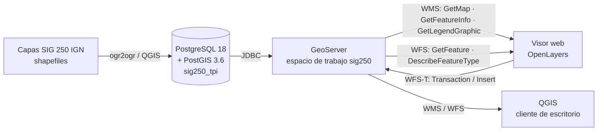

# Visor SIG 250 · TPI Sistemas de Información Geográfica 2026

Trabajo Práctico Integrador de la materia electiva **Sistemas de Información Geográfica** (4.° nivel, Ingeniería en Sistemas de Información) · **Universidad Tecnológica Nacional, Facultad Regional Resistencia** · Ciclo 2026.

Docentes: Ing. Ilse Hodapp · Ing. Rodrigo Valdés.

Integrantes del grupo:

-Almirón Sabugo, Alejo
-Dominguez, Nahuel
-Sanchez, Rosalia
-Tomas, Damian
-Vega, Lourdes
-Velazquez, Victoria
---

## Descripción

Infraestructura de datos espaciales completa, montada con software libre sobre las capas vectoriales del **SIG 250 del Instituto Geográfico Nacional (IGN)**:

1. **Servidor de bases de datos espaciales**: PostgreSQL + PostGIS, con las 47 capas del SIG 250 cargadas.
2. **Servidor de mapas**: GeoServer, que publica las capas mediante los servicios OGC **WMS** y **WFS** (incluido **WFS-T**, para edición).
3. **Aplicación web**: visor desarrollado con **OpenLayers** que consume esos servicios.

## Arquitectura



## Funcionalidades del visor

| Requisito del enunciado | Implementación |
|---|---|
| Navegación del mapa | Paneo, zoom (rueda, botones +/−), vuelta a la extensión del Chaco (⌂) y pantalla completa |
| Activar / desactivar capas | Lista de capas con casillas de verificación, más el mapa base de OpenStreetMap |
| Leyenda y escala | Leyenda por **WMS GetLegendGraphic** para cada capa activa, filtrada según la escala actual. Barra de escala gráfica, escala numérica (1:xxx) y coordenadas del cursor |
| Consulta gráfica por **punto** | **WMS GetFeatureInfo** sobre la capa elegida; resultados en tabla y resaltado en el mapa |
| Consulta gráfica por **rectángulo** | **WFS GetFeature** con filtro BBOX sobre la capa elegida |
| Medición de distancias | Distancia geodésica (sobre el elipsoide), sin la deformación de la proyección Web Mercator |
| Ingreso de nuevos elementos | Alta de puntos con atributos en la capa `incidencias_ruta` mediante **WFS-T Insert**, que se guardan en PostGIS |

## Tecnologías

| Componente | Versión utilizada |
|---|---|
| PostgreSQL | 18 |
| PostGIS | 3.6.2 |
| GeoServer | Stable (instalador para Windows) |
| Java (para GeoServer) | Eclipse Temurin 21 LTS |
| OpenLayers | 10.x (cargado desde CDN) |
| QGIS / GDAL (ogr2ogr) | Carga de datos y cliente de escritorio |
| Sistema operativo | Windows 11 |

## Estructura del repositorio

```
├── visor/                     Aplicación web (se copia a la carpeta www de GeoServer)
│   ├── index.html
│   ├── app.js
│   └── app.css
├── geoserver/
│   ├── estilos/               Estilos SLD (cada uno con el nombre de su capa)
│   └── scripts/
│       ├── cargar_capas.bat       Carga de shapefiles en PostGIS con ogr2ogr
│       ├── publicar_capas.ps1     Publicación masiva de capas (API REST)
│       └── subir_estilos.ps1      Carga y asignación de estilos (API REST)
├── sql/
│   ├── 01_crear_base.sql
│   ├── 02_normalizar_nombres.sql
│   ├── 03_incidencias_ruta.sql
│   └── 04_verificacion.sql
└── docs/capturas/             Capturas de pantalla para el informe
```

> Las capas del SIG 250 no se incluyen en el repositorio por su tamaño. Se descargan del enlace del enunciado.

---

## Instalación paso a paso

### 1. Base de datos espacial (PostGIS)

1. Instalar PostgreSQL y la extensión PostGIS (en Windows: *Application Stack Builder → Spatial Extensions → PostGIS Bundle*).
2. En pgAdmin, crear la base `sig250_tpi` y ejecutar [`sql/01_crear_base.sql`](sql/01_crear_base.sql).
3. Cargar las capas SIG 250 con una de estas dos opciones:
   - **QGIS**: *Procesos → GDAL → Miscelánea vectorial → Exportar a PostgreSQL (conexiones disponibles)*, ejecutado como proceso por lotes. Parámetros: esquema `public`, clave primaria `id`, columna de geometría `geom`, reproyectar a `EPSG:4326`, promover a multiparte, crear índice espacial y **sin** "Mantener anchura y precisión".
   - **Consola**: desde la OSGeo4W Shell, ejecutar [`geoserver/scripts/cargar_capas.bat`](geoserver/scripts/cargar_capas.bat) dentro de la carpeta de los shapefiles.
4. Ejecutar [`sql/02_normalizar_nombres.sql`](sql/02_normalizar_nombres.sql), que quita acentos, ñ y mayúsculas de los nombres de tablas y columnas.
5. Ejecutar [`sql/03_incidencias_ruta.sql`](sql/03_incidencias_ruta.sql), que crea la capa editable.
6. Verificar con [`sql/04_verificacion.sql`](sql/04_verificacion.sql). Deben quedar 48 capas: 47 del SIG 250 más `incidencias_ruta`.

### 2. Servidor de mapas (GeoServer)

1. Instalar Java 21 (Temurin) con la variable `JAVA_HOME` activada, y después GeoServer como servicio de Windows (puerto 8080).
2. **Espacio de trabajo**: nombre `sig250`, URI `http://gis.tpi/sig250`.
3. **Almacén PostGIS** `pg_sig250`: host `127.0.0.1`, puerto `5432`, base `sig250_tpi`, esquema `public`.
4. **Publicar las capas**: editar usuario y clave en [`publicar_capas.ps1`](geoserver/scripts/publicar_capas.ps1) y ejecutar:
   ```powershell
   powershell -ExecutionPolicy Bypass -File .\publicar_capas.ps1
   ```
5. **Estilos**: editar la clave en [`subir_estilos.ps1`](geoserver/scripts/subir_estilos.ps1) y ejecutarlo desde `geoserver/scripts/`. Toma los `.sld` de `geoserver/estilos/`, los sube y asigna cada uno como estilo por defecto de la capa del mismo nombre.
6. **WFS transaccional**: *Servicios → WFS → Nivel de servicio: Completo*.
7. **Permiso de escritura**: *Seguridad → Datos → Agregar nueva regla*: `sig250` / `incidencias_ruta` / Escritura / cualquier rol.
8. **Content Security Policy**: *Seguridad → Content Security Policy*. En *Allowed sources for remote web resources*, cargar:
   ```
   'self' https://cdn.jsdelivr.net https://tile.openstreetmap.org
   ```

#### Estilos (SLD)

| Capa | Simbología |
|---|---|
| `red_vial` | Por jurisdicción (`administra`): nacional, provincial, internacional y vecinal (esta última solo a escalas mayores a 1:1.500.000). Etiquetas "RN nn" |
| `localidades` | Símbolos graduados por cantidad de habitantes (`canthab`) en 5 rangos, más una clase "sin dato" |
| `puente_red_vial_puntos` | Por tipo: puente vial, colgante, viaducto, túnel |
| `incidencias_ruta` | Por tipo: bache, señalización dañada, banquina deteriorada, otra |
| `provincias`, `curso_de_agua_hid`, `espejo_de_agua_hid` | Símbolo único con etiquetas |

### 3. Aplicación web

1. Copiar el contenido de `visor/` en la carpeta `www\visor` del directorio de datos de GeoServer (en esta instalación: `C:\ProgramData\GeoServer\www\visor`).
2. Abrir **http://localhost:8080/geoserver/www/visor/index.html**.

Al servirse desde GeoServer, la aplicación y los servicios comparten el mismo origen, así que no hace falta configurar CORS.

La configuración (URL de GeoServer, espacio de trabajo y lista de capas) está al principio de [`visor/app.js`](visor/app.js). Para agregar una capa al visor alcanza con sumar una línea al arreglo `CAPAS`.

---

## Servicios OGC publicados

| Servicio | URL de ejemplo |
|---|---|
| WMS GetCapabilities | `http://localhost:8080/geoserver/sig250/wms?service=WMS&version=1.3.0&request=GetCapabilities` |
| WFS GetCapabilities | `http://localhost:8080/geoserver/sig250/wfs?service=WFS&version=2.0.0&request=GetCapabilities` |
| WFS GetFeature (GeoJSON) | `http://localhost:8080/geoserver/sig250/wfs?service=WFS&version=2.0.0&request=GetFeature&typeNames=sig250:provincias&count=3&outputFormat=application/json` |
| WMS GetLegendGraphic | `http://localhost:8080/geoserver/sig250/wms?service=WMS&version=1.3.0&request=GetLegendGraphic&format=image/png&layer=sig250:localidades` |

---

## Problemas encontrados y soluciones

| Problema | Causa | Solución |
|---|---|---|
| QGIS no conecta a `localhost:5432` ("la autentificación password falló") | `localhost` resolvía a IPv6 (`::1`) y respondía el PostgreSQL del contenedor Docker | Usar `127.0.0.1` como host |
| Una capa no se carga: *"desbordamiento de campo numeric"* | El shapefile declara `cota` como `numeric(18,15)` y hay valores de 4 dígitos | Cargar sin mantener la precisión de origen (`-lco PRECISION=NO`) |
| Nombres de tablas y columnas con acentos | Nombres originales del IGN | Script [`02_normalizar_nombres.sql`](sql/02_normalizar_nombres.sql) |
| WFS-T: *"No such feature type …"* | La URI del espacio de nombres usada en la transacción no coincidía con la del espacio de trabajo | El visor obtiene la URI real con `DescribeFeatureType` antes de cada alta |
| Java 25 instalado por defecto | GeoServer está soportado sobre Java 17 o 21 | Instalar Temurin 21 LTS |

---

## Datos

Capas vectoriales del **SIG 250** del Instituto Geográfico Nacional de la República Argentina (IGN), provistas por la cátedra. Mapa base: © colaboradores de OpenStreetMap.
